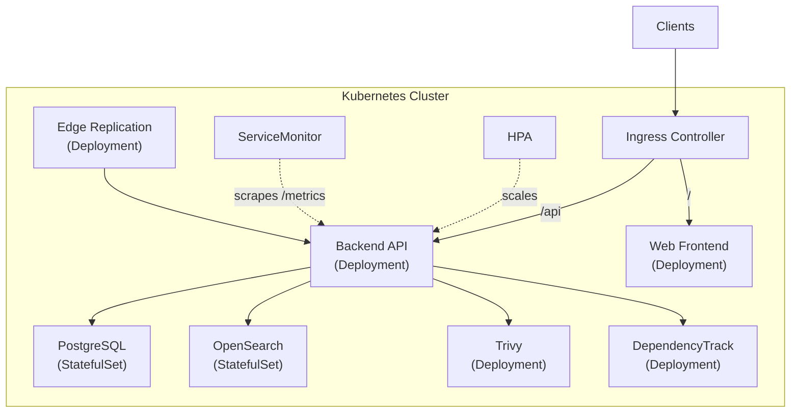

import { Tabs, TabItem } from '@astrojs/starlight/components';

:::caution[Upgrading from 1.1.x?]
This page describes 1.2.x and later. The search backend changed from Meilisearch to OpenSearch. See the [migration guide](/docs/deployment/migration-meili-to-opensearch/) for env var changes, port changes, and rollout steps.
:::

:::caution[Example Configuration]
The Helm chart, Terraform modules, ArgoCD configs, and monitoring stack are provided as **getting started templates**. They should be reviewed and modified to match your specific infrastructure requirements, security policies, and operational needs before use in production.
:::

Deploy Artifact Keeper on Kubernetes using the official Helm chart. The chart includes all services: backend API, web frontend, PostgreSQL, OpenSearch, Trivy, and DependencyTrack.

## Prerequisites

- Kubernetes 1.24+ cluster
- Helm 3.10+
- kubectl configured

## Quick Start

### 1. Add the chart

```bash
helm repo add artifact-keeper https://artifact-keeper.github.io/artifact-keeper-iac/
helm repo update
```

### 2. Install with default values (dev)

```bash
helm install ak artifact-keeper/artifact-keeper \
  --namespace artifact-keeper \
  --create-namespace
```

The chart generates the JWT secret and the PostgreSQL password and keeps them across upgrades.

:::note[Chart version]
This needs chart 1.9.53 or later, the first release with [artifact-keeper-iac#417](https://github.com/artifact-keeper/artifact-keeper-iac/pull/417). Older charts fail with `secrets.jwtSecret is required` until you add `--set secrets.jwtSecret=$(openssl rand -base64 48) --set postgres.auth.password=$(openssl rand -hex 16)`.
:::

:::caution[Argo CD and helm template]
These tools render without access to the cluster, so each render generates new values, and a new PostgreSQL password stops matching the existing database. Set `secrets.jwtSecret` and `postgres.auth.password`, or use `secrets.existingSecret`. See [Generated credentials](https://github.com/artifact-keeper/artifact-keeper-iac/tree/main/charts/artifact-keeper#generated-credentials) in the chart README.
:::

### 3. Install with production values

The overlay files live in the chart's repository. `values-production.yaml` takes its secrets from the [External Secrets Operator](https://external-secrets.io/) and its `DATABASE_URL` from an existing Secret, so before you install, set up a `ClusterSecretStore` named `aws-secrets-manager` with the entries listed under `externalSecrets.secrets` in that file, and create the `artifact-keeper-rds` Secret. Flags such as `secrets.jwtSecret` are ignored with this setup.

```bash
git clone https://github.com/artifact-keeper/artifact-keeper-iac.git
cd artifact-keeper-iac

helm install ak charts/artifact-keeper/ \
  -f charts/artifact-keeper/values-production.yaml \
  --namespace artifact-keeper \
  --create-namespace \
  --set ingress.host=registry.example.com \
  --set externalDatabase.host=your-rds-endpoint.amazonaws.com
```

To pass the secrets directly instead, turn both off:

```bash
helm install ak charts/artifact-keeper/ \
  -f charts/artifact-keeper/values-production.yaml \
  --namespace artifact-keeper \
  --create-namespace \
  --set ingress.host=registry.example.com \
  --set externalSecrets.enabled=false \
  --set externalDatabase.existingSecret= \
  --set secrets.jwtSecret=$(openssl rand -base64 48) \
  --set externalDatabase.host=your-rds-endpoint.amazonaws.com \
  --set externalDatabase.password=your-db-password
```

## Environment Overlays

The chart ships with three value files:

| File | Use Case | Replicas | PostgreSQL | Features |
|------|----------|----------|------------|----------|
| `values.yaml` | Development | 1 | In-cluster | All services, dev credentials |
| `values-staging.yaml` | Staging | 2 | In-cluster | HPA, PDB, NetworkPolicy, monitoring |
| `values-production.yaml` | Production | 3+ | External (RDS) | HPA, PDB, NetworkPolicy, monitoring, TLS |

## Architecture



## Configuration Reference

### Backend

| Parameter | Description | Default |
|-----------|-------------|---------|
| `backend.enabled` | Enable backend | `true` |
| `backend.replicaCount` | Number of replicas | `1` |
| `backend.image.tag` | Image tag | `dev` |
| `backend.resources.requests.cpu` | CPU request | `250m` |
| `backend.resources.requests.memory` | Memory request | `256Mi` |
| `backend.persistence.size` | Storage size | `10Gi` |
| `backend.autoscaling.enabled` | Enable HPA | `false` |
| `backend.podDisruptionBudget.enabled` | Enable PDB | `false` |

### Database

| Parameter | Description | Default |
|-----------|-------------|---------|
| `postgres.enabled` | Deploy in-cluster PostgreSQL | `true` |
| `postgres.auth.username` | DB username | `registry` |
| `postgres.auth.database` | DB name | `artifact_registry` |
| `postgres.persistence.size` | DB storage | `20Gi` |
| `externalDatabase.host` | External DB host (when postgres.enabled=false) | `""` |
| `externalDatabase.existingSecret` | Use existing K8s secret for DB URL | `""` |

### Security Scanning

| Parameter | Description | Default |
|-----------|-------------|---------|
| `trivy.enabled` | Enable Trivy scanner | `true` |
| `dependencyTrack.enabled` | Enable DependencyTrack | `true` |
| `dependencyTrack.bootstrap.enabled` | Auto-configure DependencyTrack | `true` |

### Search (OpenSearch)

Search is handled by a top-level `opensearch:` values block. The chart ships an in-cluster single-node OpenSearch StatefulSet by default. For external OpenSearch clusters (managed service, existing shared cluster), disable the in-cluster deployment and point the backend at the external endpoint via `backend.env`.

| Parameter | Description | Default |
|-----------|-------------|---------|
| `opensearch.enabled` | Deploy in-cluster OpenSearch | `true` |
| `opensearch.image.repository` | OpenSearch image | `opensearchproject/opensearch` |
| `opensearch.image.tag` | Image tag | `2.19.1` |
| `opensearch.persistence.size` | Storage size | `20Gi` |
| `opensearch.auth.username` | Admin username | `admin` |
| `opensearch.auth.existingSecret` | Use existing K8s secret for the admin password | `""` |

The chart change that introduces this top-level block is landing in a companion PR to `artifact-keeper-iac`. Until that chart version is released, stick with the previous values schema.

### Ingress

| Parameter | Description | Default |
|-----------|-------------|---------|
| `ingress.enabled` | Enable Ingress | `true` |
| `ingress.className` | Ingress class | `nginx` |
| `ingress.host` | Hostname | `artifacts.example.com` |
| `ingress.tls.enabled` | Enable TLS | `false` |

### Monitoring

| Parameter | Description | Default |
|-----------|-------------|---------|
| `serviceMonitor.enabled` | Enable Prometheus ServiceMonitor | `false` |
| `serviceMonitor.interval` | Scrape interval | `30s` |
| `networkPolicy.enabled` | Enable NetworkPolicy | `false` |

## Production Deployment

For production, we recommend:

1. **Use external PostgreSQL (RDS)** — Set `postgres.enabled: false` and configure `externalDatabase.*`
2. **Use S3 for artifact storage** — Configure S3 env vars in `backend.env`
3. **Enable TLS** — Set `ingress.tls.enabled: true` with cert-manager
4. **Enable monitoring** — Set `serviceMonitor.enabled: true` with kube-prometheus-stack
5. **Enable network policies** — Set `networkPolicy.enabled: true`
6. **Use external secrets** — Use `externalDatabase.existingSecret` for database credentials

## Upgrading from Meilisearch (1.1 to 1.2)

Artifact Keeper 1.2 replaces Meilisearch with OpenSearch as the search backend. If you are upgrading an existing Helm release from 1.1.x, follow the [Meilisearch to OpenSearch migration guide](/docs/deployment/migration-meili-to-opensearch) before running `helm upgrade`. The backend will re-index from PostgreSQL on first boot, so no search data needs to be migrated.

## Using Docker Hub Instead of ghcr.io

To pull the backend and web images from Docker Hub instead of the default ghcr.io:

```bash
helm install artifact-keeper artifact-keeper/artifact-keeper \
  --set backend.image.registry=docker.io \
  --set backend.image.repository=artifactkeeper/backend \
  --set web.image.registry=docker.io \
  --set web.image.repository=artifactkeeper/web
```

The scanner adapter and Trivy images are published only on ghcr.io, so they stay there. Don't use `global.imageRegistry` for this: it would point them at Docker Hub paths that don't exist.

## Upgrading

```bash
# Upgrade with new values
helm upgrade ak charts/artifact-keeper/ \
  -f charts/artifact-keeper/values-production.yaml \
  --namespace artifact-keeper

# Check rollout status
kubectl rollout status deployment/ak-artifact-keeper-backend -n artifact-keeper
```

## Uninstalling

```bash
helm uninstall ak --namespace artifact-keeper
kubectl delete namespace artifact-keeper
```

## Security Stack

The Helm chart integrates two open-source security scanning tools:

- **[Trivy](https://trivy.dev/)** (Apache 2.0) — Vulnerability scanner for container images, filesystems, and code repositories by Aqua Security
- **[DependencyTrack](https://dependencytrack.org/)** (Apache 2.0) — SBOM analysis platform by OWASP for continuous component risk identification

Both are included in the default deployment and require no additional licensing.
