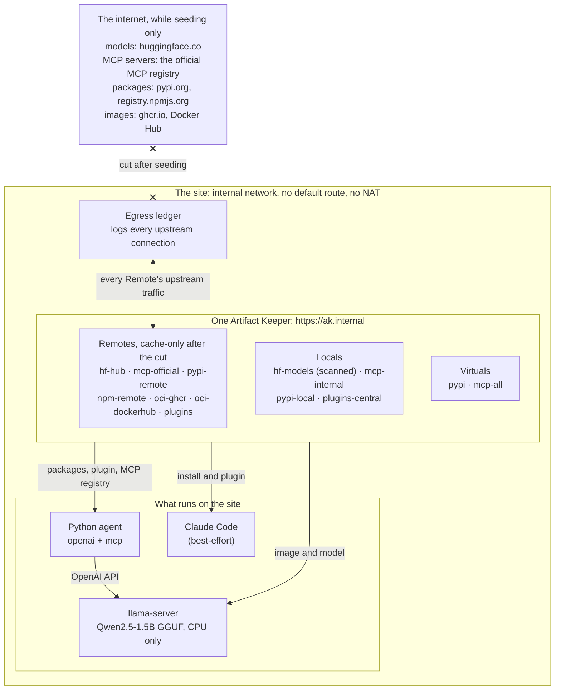
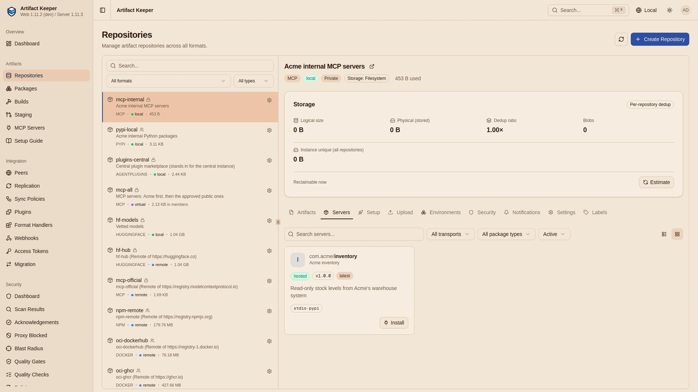
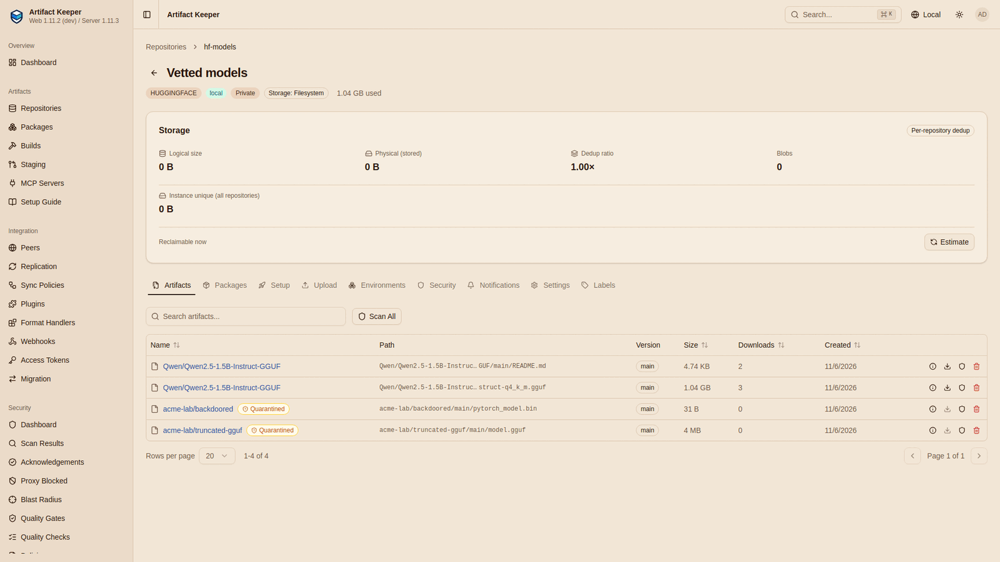
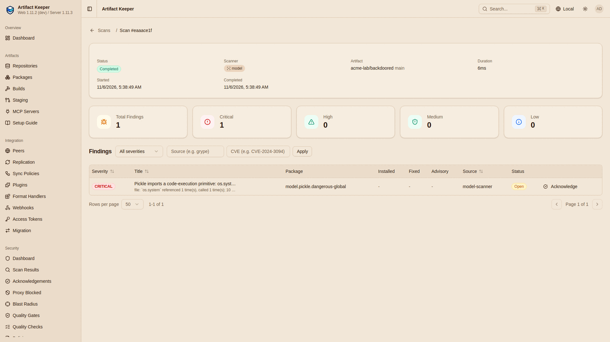
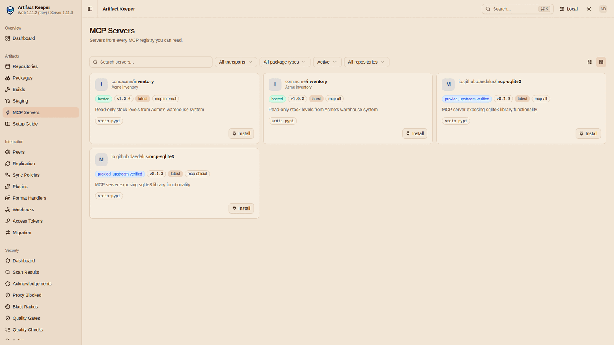
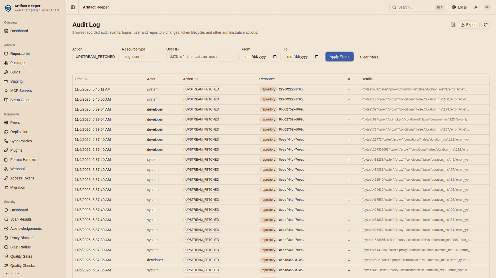

import { Aside } from '@astrojs/starlight/components';
import ComingIn from '../../../../components/ComingIn.astro';

<ComingIn>
  The walkthrough ran on the CI images of Artifact Keeper `main` at `88f23c51`. Cache-only Remotes, cache seeding, the model-file scanner, the `UPSTREAM_FETCHED` audit event, the switch that pauses upstream jobs, the scanner adapter's offline mode, config export, and the MCP Registry and Agent Plugins formats all ship in 1.12.0. Each is marked where it appears below.
</ComingIn>

**Run your whole AI stack (models, MCP tools, agent plugins and every package under them) from one registry you own, on a network nothing leaves.**

An AI agent is not one download. It is a model from Hugging Face, a model server in a container image, a few dozen Python packages, the MCP servers it calls as tools, and the plugin that tells it which servers to start. Each comes from a different public service, and each of those services is a place the stack reaches out to.

That is a problem anywhere the internet is not: a factory floor, a ship, a classified enclave, a lab that must not leak. It is also a problem for anyone who wants to know exactly what their AI stack depends on.

The [off-grid AI stack walkthrough](https://github.com/artifact-keeper/walkthroughs/tree/main/off-grid-ai-stack) puts every layer behind one Artifact Keeper instance. It seeds the registry while the network is up, vets what came in, cuts the cable, and runs an agent that still answers. Then it proves that nothing left: a logging proxy, the audit log and the network itself all check it, and a control opens one hole on purpose to show they would have seen it. `make all` builds it from an empty registry and `make gates` checks every claim on this page. No account is needed anywhere: no Hugging Face token, no API key, no Claude login.

{/*
  DEMO VIDEO SLOT. A separate effort is recording the demo (beats in off-grid-ai-stack/demo/SCRIPT.md of
  artifact-keeper/walkthroughs). When the file exists, replace the Aside below with a <video controls
  preload="none" playsinline> served from public/use-cases/off-grid-ai-stack.mp4 (see docs/use-case-videos.md).
  Do not put a stand-in video here.
*/}

<Aside type="note" title="Demo video: coming soon">
  A two-to-three-minute recording of this run (seed, vet, cut, the agent, zero egress) is being made and will
  play here. Until then, the terminal recordings it is cut from are in the walkthrough's
  [`demo/casts/`](https://github.com/artifact-keeper/walkthroughs/tree/main/off-grid-ai-stack/demo/casts).
</Aside>

## The stack in one diagram



Everything the site runs comes from one place: the model server's image and the model, every Python package of the agent (each hash-pinned), Acme's own MCP server, one public MCP server from the official registry, the agent's plugin, and Claude Code itself. Every Remote sends its upstream traffic through a logging forward proxy, the egress ledger, so whatever goes out is written down. While seeding, the same stack sits on a network with a route out. After the cut it is recreated on one without.



## The flow

Each step below is one `make` target in the [lab](https://github.com/artifact-keeper/walkthroughs/tree/main/off-grid-ai-stack). The output is from the reference run unless a step says otherwise.

### 1. Seed: everything on one manifest

Everything the site will need is listed in one file, [`seed/manifest.toml`](https://github.com/artifact-keeper/walkthroughs/blob/main/off-grid-ai-stack/seed/manifest.toml). `make seed` pulls all of it through Artifact Keeper while the network is up: images by digest, Python and npm packages, the model at a commit, one public MCP server by name and version, and the plugin. Anything not in the manifest is not on the site afterwards.

<ComingIn inline /> The model is not downloaded by a client. The `hf-hub` Remote fills its own cache from a list of commit-pinned paths with the cache-seed API:

```console
== 2. the model: a cache-seed job on hf-hub, commit-pinned paths (Qwen/Qwen2.5-1.5B-Instruct-GGUF@91cad51170dc)
  POST /api/v1/repositories/hf-hub/cache/seed: HTTP 202 {"job_id":"882d4ee6-a7ec-4928-aec6-7730128c81eb","status":"pending","total_items":3}
{"status":"completed","summary":{"pending":0,"cached":3,"already_cached":0,"refused":0,"failed":0,"cached_bytes":1117332630}}
```

<ComingIn inline /> The public MCP server, `io.github.daedalus/mcp-sqlite3` 0.1.3, is seeded by name and version with a reason on record. That is two requests to the official registry instead of paging its 221,769 entries:

```bash
POST /api/v1/repositories/mcp-official/mcp/seed
{"servers": [{"name": "io.github.daedalus/mcp-sqlite3", "version": "0.1.3"}],
 "reason": "reviewed for the off-grid site: local SQLite only, no network"}
```

Full detail: [Step 2, Seed the stack](https://artifact-keeper.github.io/walkthroughs/off-grid-ai-stack/2-seed-the-stack/).

### 2. Vet: the model goes through a door that scans it

<ComingIn inline /> `make vet` publishes the seeded model to `hf-models`, a Local repository where every upload is scanned, including by the model-file scanner. A policy serves a file only once a scan has completed with nothing at or above medium. Two counter-examples go through the same door: the first 4 MiB of the real GGUF, and a 31-byte pickle that imports `os.system`.

```console
    findings: [{"severity":"medium","rule":"model.gguf.malformed","title":"GGUF header is malformed: file"}]
    GET .../resolve/main/model.gguf: HTTP 403
    findings: [{"severity":"critical","rule":"model.pickle.dangerous-global","title":"Pickle imports a code-execution primitive: os.system"}]
    GET .../resolve/main/pytorch_model.bin: HTTP 403
```

The real model scans clean and is served. The two counter-examples are quarantined:





<ComingIn inline /> The same step imports the trivy database, seeded through the registry, into the scanner adapter running in offline mode, and scans the llama.cpp image with no network beyond the stack. It also exports the whole configuration as one document and writes the inventory of record: 85 items, each with its SHA-256.

Full detail: [Step 3, Vet what you seeded](https://artifact-keeper.github.io/walkthroughs/off-grid-ai-stack/3-vet-what-you-seeded/).

### 3. Disconnect: a handful of settings and a network with no route out

<ComingIn inline /> `make disconnect` pauses the scheduled upstream jobs, sets every Remote to cache-only, exports the configuration again, writes down the counters the zero-egress checks start from, and recreates every container on a network with no default route and no NAT.

```bash
PATCH /api/v1/admin/settings/system {"upstream_jobs_paused": true}
PUT /api/v1/repositories/<remote>/upstream-mode {"upstream_mode": "cache_only"}
```

```console
== 4. the marks
{
  "at": "2026-11-06T05:13:07Z",
  "ledger_lines": 24,
  "upstream_fetched": 283,
  "mcp_mirror_synced": 0
}
```

Everything the site will ever have came over 24 connections and 283 upstream requests. A cache-only Remote serves what it has cached and never asks upstream; a miss is a clean `404` at once.

Full detail: [Step 4, Disconnect](https://artifact-keeper.github.io/walkthroughs/off-grid-ai-stack/4-disconnect/) and [Air-Gapped Deployments](/docs/deployment/air-gapped/).

### 4. The agent: it still answers

<ComingIn inline /> On the disconnected site, `make agent` pulls the llama.cpp image again through the registry, downloads the vetted model with the stock `hf download` (`HF_ENDPOINT` points at `hf-models`), and installs every Python package from the registry alone, hash-checked. Then a small Python agent installs its plugin from Artifact Keeper, verifies its SHA-256, and starts an MCP server only if the registry `mcp-all` lists that package at the installed version. The local model calls the inventory tool and answers:

```console
  [   8.4s] llm-turn: {"turn": 0, "seconds": 4.2, "tool_calls": ["stock_level"], "content": ""}
  [   8.4s] tool-call: {"tool": "stock_level", "arguments": {"sku": "OG-1138", "warehouse": "north"}, "result": "{\n  \"sku\": \"OG-1138\",\n  \"warehouse\": \"north\",\n  \"units\": 42,\n  \"ref\": \"inv-7f3a9c\"\n}"}
  [  10.3s] llm-turn: {"turn": 1, "seconds": 1.9, "tool_calls": [], "content": "There are 42 units of SKU OG-1138 in the north warehouse. (ref: inv-7f3a9c)"}
```

The `ref` is a fixed value the model cannot guess, so the answer provably came from the tool. Two MCP servers are approved: Acme's own, hosted in `mcp-internal`, and the public one from the official registry.



Claude Code also installs from the registry on the site and gets its plugin there. Its session with a 1.5B model on a CPU is labelled best-effort: shown, not promised.

Full detail: [Step 5, Run the agent offline](https://artifact-keeper.github.io/walkthroughs/off-grid-ai-stack/5-run-the-agent-offline/) and [Step 6, Claude Code](https://artifact-keeper.github.io/walkthroughs/off-grid-ai-stack/6-claude-code-best-effort/).

### 5. Prove zero egress: the network, two records and a control

No single measurement proves that nothing left, so gate G7 makes several independent ones. A probe joins each running container's network namespace and finds no route out. <ComingIn inline /> The egress ledger gained no connection, the audit log gained no `UPSTREAM_FETCHED` row, the cache metrics show the site was served from cache, and the site serves exactly the seeded inventory.

```console
PASS              G7a  no route out from any of the 8 running containers (stack, ledger, llama-server)
ledger: 24 connections at the disconnect, 24 now; opened since then: 0, of them outside control windows: 0
UPSTREAM_FETCHED since 2026-11-06T05:13:07Z: 0 rows, 0 outside the control windows
MCP_MIRROR_SYNCED since 2026-11-06T05:13:07Z: 0 rows, 0 outside the control windows
PASS              G7e  the site serves exactly the seeded inventory (85 items, same SHA-256 each)
```

A quiet ledger proves something only if it would have caught an attempt. So the gate pokes one hole on purpose: it puts `pypi-remote` back online and asks for a package nobody seeded. The attempt shows up in the ledger and the audit log. Sealed again, the same request is a fast `404` that leaves no trace:

```console
control: ledger connections 24 -> 25 (hole) -> 25 (sealed); UPSTREAM_FETCHED rows: 1 in the hole, 0 after sealing
PASS              G7   control: sealed again, the same request adds no ledger line and no audit row, and is a 404
```

The same check in the web UI, from the run the screenshots come from (disconnected at 05:41:03 UTC). The audit page filters by day, so the rows from before the cut are listed too; the one row after it, at 5:46:11, is that run's control trying pypi.org.



Full detail: [Step 7, Prove nothing leaves](https://artifact-keeper.github.io/walkthroughs/off-grid-ai-stack/7-prove-nothing-leaves/).

### 6. Fails safely: a fast, clear no

<ComingIn inline /> What was not seeded is not fetched and not waited on. Gate G6 asks for five things nobody seeded, one per kind of Remote, and each is a `404` in milliseconds, a status a client does not retry:

```console
a model file nobody seeded (hf-hub): GET /huggingface/hf-hub/Qwen/Qwen2.5-0.5B-Instruct-GGUF/resolve/main/qwen2.5-0.5b-instruct-q4_k_m.gguf -> HTTP 404 in 42 ms
a PyPI project nobody seeded (pypi Virtual): GET /pypi/pypi/simple/rich-click/ -> HTTP 404 in 62 ms
an image tag nobody seeded (oci-ghcr): GET /v2/oci-ghcr/ggml-org/llama.cpp/manifests/server-b5000 -> HTTP 404 in 348 ms
an npm package nobody seeded (npm-remote): GET /npm/npm-remote/left-pad -> HTTP 404 in 40 ms
a plugin version nobody published (plugins Remote): GET /agentplugins/plugins/offgrid-ops/9.9.9/offgrid-ops-9.9.9.zip -> HTTP 404 in 38 ms
```

An MCP server nobody approved is not listed. An admin who tries to seed or sync another public MCP server on the site gets a `409` that says why, and nothing goes upstream. Run against a registry that does not list `mcp-sqlite3`, the agent refuses to start it.

Full detail: [Step 8, Prove it fails safely](https://artifact-keeper.github.io/walkthroughs/off-grid-ai-stack/8-prove-it-fails-safely/).

## What it proves

These numbers are from **one lab run**: the reference run on 2026-11-06, on one host (Ubuntu 26.04 LTS, 40 cores, 108 GB RAM, rootless podman 5.7.0), from a fresh clone of the walkthrough at `de0597c` and an empty registry, on the CI images of Artifact Keeper `main` at `88f23c51`. Your timings will differ.

| | One lab run |
|---|---|
| Empty registry to an agent answering offline | `make all`: 11 min 12 s (Qwen2.5-1.5B); 9 min 16 s with `SMALL_MODEL=1` (Qwen2.5-0.5B) |
| Proving it | `make gates`: 2 min 6 s, **73 PASS, 0 FAIL, 0 BLOCKED** of 73 checks |
| The model | `Qwen/Qwen2.5-1.5B-Instruct-GGUF` at commit `91cad51170dc`, 1,117,320,736 bytes, on llama.cpp, CPU only, 16 threads |
| Seeding the model | one cache-seed request; 63 s for 1.1 GB |
| What went out while seeding, up to the cut | 283 upstream requests over 24 connections, to 12 hosts; the ledger and the audit log name the same hosts |
| The public MCP server | 2 requests to the official registry, instead of paging its 221,769 entries |
| The answer | "There are 42 units of SKU OG-1138 in the north warehouse. (ref: inv-7f3a9c)"; the agent ran 10.6 s end to end |
| Egress after the cut | **0** ledger connections, **0** `UPSTREAM_FETCHED` rows, **0** `MCP_MIRROR_SYNCED` rows; no route out from any of the 8 running containers |
| The control | one hole opened on purpose: 1 ledger connection and 1 audit row; sealed: 0 and 0, and a `404` in 37 ms |
| Fails fast | everything not seeded is a `404` in 37 to 348 ms; an MCP seed or sync on the site is a `409` |
| Vetting | a truncated GGUF flagged `model.gguf.malformed` (medium), a pickle that calls `os.system` flagged `model.pickle.dangerous-global` (critical); both refused with `403` |
| Inventory | 85 items, the same SHA-256 on the site as at the seed |

With `SMALL_MODEL=1`, the gates ended at 71 PASS, 0 FAIL and 1 BLOCKED of 72: the blocked check is the best-effort Claude Code session. Both runs are side by side on the [Results](https://artifact-keeper.github.io/walkthroughs/off-grid-ai-stack/results/) page.

<Aside type="caution" title="What it does not prove">
  - **An example configuration, not a complete defence.** It was built and tested in a lab, it does not cover every edge case or attack, and it is not a hardened production setup. Use it alongside your other controls (network policy, egress firewalls, sandboxed inference, monitoring), not instead of them.
  - **"Nothing leaves" is shown for this lab's containers on this lab's network.** The proof is only as strong as the network isolation under it. In production the isolation is your network design; these checks are how you test it.
  - **Scanning has limits.** The model-file scanner reads structure: GGUF and safetensors headers, and the opcodes of a pickle. It does not judge what a model does. A well-formed GGUF with poisoned weights, a backdoor trigger or a bad chat template scans clean. A clean scan means "nothing known-bad in the file's structure", not "safe".
  - **Approving a remote MCP server means trusting its operator.** The registry check ties a running server to an approved entry by package name and version. It is not a behavioural check: approving `io.github.daedalus/mcp-sqlite3` means trusting its code and the operator behind its package on pypi.org. On the site, the network is what limits what an approved server can do.
</Aside>

The walkthrough's [lab notes](https://artifact-keeper.github.io/walkthroughs/off-grid-ai-stack/findings/) list the Artifact Keeper bugs and gaps it found on the way, and the fix for each.

## Run it yourself

You need a Linux host with rootless podman 5.x and a compose provider, about 8 GB of free RAM and 20 GB of disk, no GPU, and internet access while seeding. The [walkthrough's index](https://artifact-keeper.github.io/walkthroughs/off-grid-ai-stack/) has the full list.

```bash
git clone https://github.com/artifact-keeper/walkthroughs
cd walkthroughs/off-grid-ai-stack
make all      # registry, bootstrap, seed, vet, disconnect, agent, claude
make gates    # the seven gates
```

`SMALL_MODEL=1 make all` uses Qwen2.5-0.5B (491 MB) instead of Qwen2.5-1.5B (1.1 GB).

- [The off-grid AI stack walkthrough](https://github.com/artifact-keeper/walkthroughs/tree/main/off-grid-ai-stack) on GitHub, and [its pages](https://artifact-keeper.github.io/walkthroughs/off-grid-ai-stack/)

It is the last of a series. Each of the others puts one layer of the stack behind Artifact Keeper:

- [Private model hub](https://github.com/artifact-keeper/walkthroughs/tree/main/private-model-hub): the models, from Hugging Face
- [Private MCP registry](https://github.com/artifact-keeper/walkthroughs/tree/main/private-mcp-registry): the agent's MCP tools
- [Private agent plugin marketplace](https://github.com/artifact-keeper/walkthroughs/tree/main/private-agent-plugin-marketplace): the agent's plugins
- [AI agent dependency guardrails](https://github.com/artifact-keeper/walkthroughs/tree/main/ai-agent-dependency-guardrails): the packages the agent installs

And the docs for each piece:

- [MCP Registry](/docs/guides/mcp-registry/) <ComingIn inline />
- [Agent Plugins](/docs/guides/agent-plugins/) <ComingIn inline />
- [Hugging Face](/docs/guides/more-formats/#huggingface)
- [Air-Gapped Deployments](/docs/deployment/air-gapped/)
- [Vulnerability Scanning](/docs/security/scanning/)
- [Remote & Virtual Repositories](/docs/advanced/remote-virtual/)
